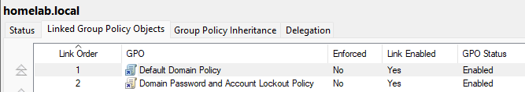
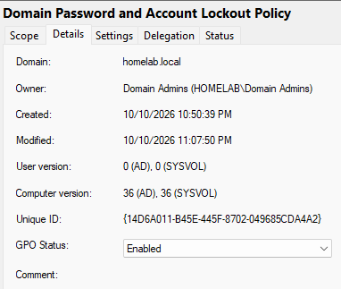
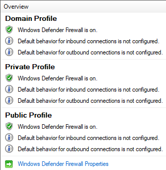
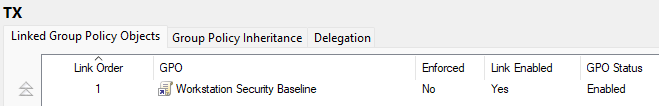
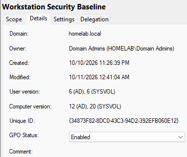
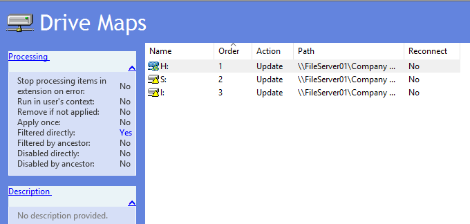
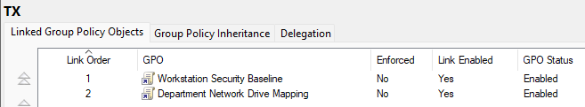
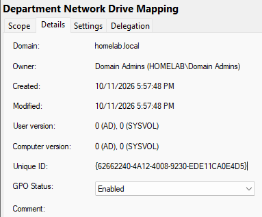
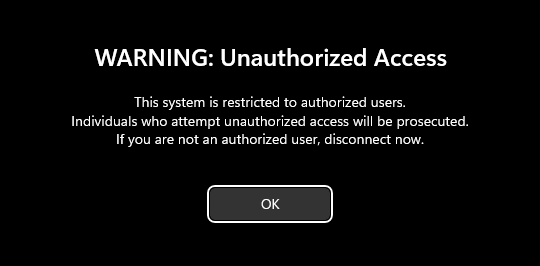
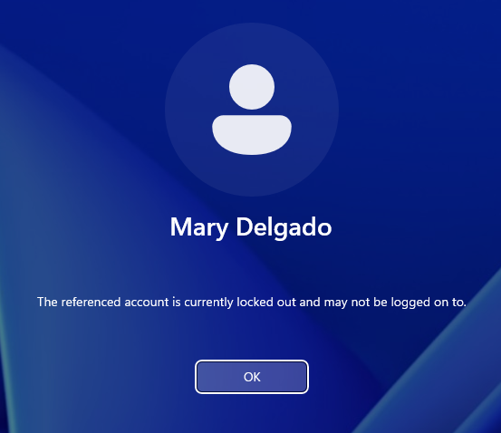

[← Back to Main README](../README.md)

# Group Policy Objects (GPO) Configuration

## Overview

This section documents the creation and configuration of Group Policy Objects (GPOs) in the Windows Server 2025 home lab.

## Objectives

- Setup strong password requirements
- Map network drives for users upon login
- Set a default desktop wallpaper for all users
- Prevent users from using USB drives
- Strengthen Windows 11 workstation security
- Control GPO scope through Organizational Units and security groups
- Apply Group Policy updates
- Verify GPO application and troubleshoot policy issues

---

## Prerequisites

- Windows Server 2025 configured as a Domain Controller
- Active Directory Domain Services installed and operational
- Group Policy Management installed
- AD organizational structure created
- Domain-joined Windows 11 client`
- Active Directory user accounts and departmental security groups configured
- Departmental file shares configured and accessible on `FileServer01`
- Administrative access to the Domain Controller

---

## Lab Environment

| Component | Configuration |
|---|---|
| Hypervisor | VMware Workstation |
| Operating System | Windows Server 2025 |
| Domain Controller | `FileServer01` |
| Active Directory Domain | `homelab.local` |
| Windows Client | Windows 11 |
| Client Computer Name | `Computer01` |

---

## Create a Domain Password and Account Lockout Policy

Created a GPO to establish password requirements and account lockout settings for domain user accounts.

> Note: Domain password and account lockout policies should be configured through a GPO linked at the domain level. Linking these account policies only to a departmental OU will not establish the domain-wide account policy.

### Create the GPO

1. Opened **Group Policy Management**.
2. Right-clicked `homelab.local` under **Domains**.
3. Selected **Create a GPO in this domain, and Link it here**.
4. Named the GPO `Domain Password and Account Lockout Policy`.
5. Select **OK**.
6. Right-clicked the new GPO.
7. Select **Edit**.

### Configure Password Policy

In the Group Policy Management Editor, navigated to:

`Computer Configuration → Policies → Windows Settings → Security Settings → Account Policies → Password Policy`

Configured the following settings:

| Policy | Example Configuration |
|---|---|
| Minimum password length | 12 characters |
| Password must meet complexity requirements | Enabled |
| Maximum password age | 90 day |
| Enforce password history | 10 passwords remembered |
| Minimum password age | 1 day |

> Note: The remaining policies were left as default.
> 
> Enabled **User must change password at next logon** and disabled **Password never expires** for all users in Active Directory to test password requirements later.


### Configure Account Lockout Policy

Navigate to:

`Computer Configuration → Policies → Windows Settings → Security Settings → Account Policies → Account Lockout Policy`

Configure the following settings:

| Policy | Example Configuration |
|---|---|
| Account lockout threshold | 5 invalid logon attempts |
| Account lockout duration | 0 minutes |
| Reset account lockout counter after | 30 minutes |

**Summary**:
These settings help reduce the risk of password guessing by locking accounts after five consecutive failed logon attempts. Locked accounts must be manually unlocked by an administrator, while the failed-attempt counter resets after 30 minutes.

### Save and Verify the GPO

1. Closed the Group Policy Management Editor.
2. Returned to Group Policy Management.
3. Confirmed that `Domain Password and Account Lockout Policy` is linked to `homelab.local`.
4. Confirmed that the GPO is enabled.





---

## Create a Workstation Security Baseline GPO

Create a second GPO to configure security settings for domain-joined Windows workstations.

### Create the GPO

1. Opened **Group Policy Management**.
2. Expanded OU and right-clicked `TX`.
3. Selected **Create a GPO in this domain, and Link it here**.
4. Named the GPO `Workstation Security Baseline` → Selected **OK**.
5. Right-clicked the GPO and selected **Edit**.

### Configure Windows Defender Firewall

Navigated to:

`Computer Configuration → Policies → Windows Settings → Security Settings → Windows Defender Firewall with Advanced Security`

1. Selected **Windows Defender Firewall with Advanced Security**.
2. Configured the firewall to remain enabled for the Domain, Private, and Public profiles.
3. Left the default inbound and outbound connections → Applied

> Keeping the firewall enabled helps protect the workstation from unsolicited inbound network connections.



### Configure Automatic Screen Lock

Navigate to:

`User Configuration → Policies → Administrative Templates → Control Panel → Personalization`

Configured the following settings:

| Policy | Configuration |
|---|---|
| Enable screen saver | Enabled |
| Password protect the screen saver | Enabled |
| Screen saver timeout | Enabled; 600 seconds |

> The screen saver timeout is set to 600 seconds (10 minutes). Password protection requires the user to authenticate again after the workstation locks.

### Configure an Interactive Logon Message

Navigated to:

`Computer Configuration → Policies → Windows Settings → Security Settings → Local Policies → Security Options`

Configured the following policies:

- **Interactive logon: Message title for users attempting to log on**
- **Interactive logon: Message text for users attempting to log on**

Configured the following message:

```text
Title: WARNING: Unauthorized Access

Message: This system is restricted to authorized users.
Individuals who attempt unauthorized access will be prosecuted.
If you are not an authorized user, disconnect now.
```

### Save and Verify the GPO

1. Closed the Group Policy Management Editor.
2. Returned to Group Policy Management.
3. Confirmed that `Workstation Security Baseline` is linked to the `TX` OU.
4. Confirmed that the GPO link is enabled.





---

## Configure Departmental Network Drive Mappings

Created a third GPO to map departmental shared folders as network drives based on Active Directory security group membership.

This configuration integrates Group Policy with the file shares created in the previous section.

> Note: Before proceeding, the shared drives that were manually mapped in the last section were removed so that this GPO can be used to map them for all users automatically.

### Create the GPO

1. Opened **Group Policy Management**.
2. Right-clicked the `TX` OU.
3. Selected **Create a GPO in this domain, and Link it here**.
4. Named the GPO `Department Network Drive Mapping` and selected **OK**.
5. Right-clicked the GPO and select **Edit**.

### Configure the HR Network Drive

Navigated to:

`User Configuration → Preferences → Windows Settings → Drive Maps`

1. Right-clicked **Drive Maps**.
2. Selected **New → Mapped Drive**.
3. Left **Action** as `Update`.
4. Set **Location** to `\\FileServer01\Company Data\HR`.
5. Entered `Human Resources` as the label.
6. Chose `H:` as the shared drive letter.
7. Opened the **Common** tab.
8. Enabled **Item-level targeting** and selected **Targeting**.
9. Added a **Security Group** targeting item.
10. Specified the `HOMELAB\HR` security group and saved the configuration.

> Note: The drive mapping will be applied only when the logged-on user belongs to the HR security group.

### Configured the Sales Network Drive

Created another mapped drive item with the following settings:

| Setting | Configuration |
|---|---|
| Action | Update |
| Location | `\\FileServer01\Company Data\Sales` |
| Drive Letter | `S:` |
| Label | Sales |
| Item-level targeting | `HOMELAB\Sales` security group |

### Configured the IT Network Drive

Create another mapped drive item with the following settings:

| Setting | Configuration |
|---|---|
| Action | Update |
| Location | `\\FileServer01\Company Data\IT` |
| Drive Letter | `I:` |
| Label | IT |
| Item-level targeting | `HOMELAB\IT` security group |



### Verify the Drive Mapping GPO

1. Closed the Group Policy Management Editor.
2. Confirmed that `Department Network Drive Mapping` is linked to the `TX` OU.
3. Confirmed that the GPO is enabled.
4. Verified that each mapped drive item has the correct UNC path and item-level targeting.

> **Note:** These drive mapping preferences do not grant file access by themselves. The corresponding share and NTFS permissions created in the last section is what actually allows the users to access the folders.





---

## Verify Applied Group Policies

Logged on as `Mary Delgado` after configuring the GPOs and ran `gpupdate /force`.

Verified all GPO's are working as intended:

### Logon Message:



### Account Lockout:



---

### Verify with Group Policy Results

1. Open **Group Policy Management** on `FileServer01`.
2. Right-click **Group Policy Results**.
3. Select **Group Policy Results Wizard**.
4. Select `Computer01` as the target computer.
5. Select the appropriate logged-on user if prompted.
6. Complete the wizard.
7. Review the resulting report for applied and denied GPOs.


---

## Test Group Policy Configuration

Verify that each GPO behaves as intended.

### Test Domain Password Policy

1. Confirm that the password policy GPO is linked at the domain level.
2. Review the configured password requirements in Group Policy Management.
3. Use a dedicated test account to validate password requirements where appropriate.
4. Avoid repeated failed attempts against important accounts while testing account lockout behavior.

Password policy changes do not necessarily force existing passwords to change immediately. Test the configured requirements with a suitable test account and document the observed result.

### Test Workstation Security Settings

On `Computer01`:

1. Run `gpupdate /force`.
2. Run `gpresult /r`.
3. Confirm that `Workstation Security Baseline` appears in the applied computer policies.
4. Verify that Windows Defender Firewall remains enabled.
5. Verify that the configured logon notice appears.
6. Verify the screen lock behavior after the configured timeout, if the user policy is in scope.

### Test Departmental Drive Mappings

1. Sign in to `Computer01` as the HR test user.
2. Confirm that the `H:` drive appears and opens `\\FileServer01\HR`.
3. Sign out and sign in as the Sales test user.
4. Confirm that the `S:` drive appears and opens `\\FileServer01\Sales`.
5. Sign in as the IT test user.
6. Confirm that the `I:` drive appears and opens `\\FileServer01\IT`.
7. Verify that users cannot access departmental shares for which they lack permission.

The drive mappings depend on user policy scope, group membership, DNS resolution, SMB connectivity, and the existing file share permissions.

### Test Results

| Test | Expected Result | Status |
|---|---|---|
| Domain password policy configured | Password requirements are configured at the domain level | Pending |
| Account lockout policy configured | Lockout threshold and duration are configured | Pending |
| Workstation Security Baseline applied | GPO appears in applied computer policies | Pending |
| Windows Defender Firewall | Firewall remains enabled | Pending |
| Interactive logon notice | Configured notice appears before sign-in | Pending |
| HR drive mapping | HR user receives the HR drive | Pending |
| Sales drive mapping | Sales user receives the Sales drive | Pending |
| IT drive mapping | IT user receives the IT drive | Pending |
| Unauthorized file access | Access is denied where no applicable permission exists | Pending |

Update the status column after performing each test.


---

## Troubleshoot Group Policy

If a policy does not apply as expected, verify the following.

### Verify GPO Links

1. Open Group Policy Management.
2. Confirm that the GPO is linked to the correct domain or OU.
3. Confirm that the link is enabled.
4. Check whether inheritance is blocked or enforced links affect the expected result.

### Verify the Computer and User OU Locations

- Computer policies are processed according to the computer account's effective Group Policy scope.
- User policies are processed according to the user account's effective Group Policy scope, subject to any configured loopback processing.
- A computer located in `TX → IT` does not automatically cause HR or Sales user policies to apply to users in other OUs.

### Verify Security Filtering

1. Select the GPO in Group Policy Management.
2. Review **Scope → Security Filtering**.
3. Confirm that the intended computer or user has the required permissions to read and apply the GPO.
4. Check the **Delegation** tab if permissions appear incorrect.

Avoid removing `Authenticated Users` without first configuring appropriate read and apply permissions for the intended target accounts.

### Review Group Policy Results

Run:

```powershell
gpresult /r
```

For additional detail:

```powershell
gpresult /h "%USERPROFILE%\Desktop\gpresult.html"
```

Review the report for denied policies, filtering issues, and unexpected scope.

### Verify DNS and Domain Connectivity

From `Computer01`, run:

```powershell
nslookup homelab.local
nslookup FileServer01
```

Confirm that DNS resolves through the Active Directory DNS server and that the client can communicate with the Domain Controller.

---

## Final Group Policy Configuration

After completing this section, the lab should include:

- A domain-level password and account lockout policy
- A workstation security baseline linked to the appropriate OU
- A departmental network drive mapping GPO
- Group Policy scope configured for the intended users and computers
- Group Policy updates applied to the Windows 11 client
- Verification of applied policies using `gpresult` and Group Policy Results
- Testing of departmental drive mappings and file share access
- Troubleshooting of policy application and scope

## Skills Demonstrated

- Group Policy Management Console administration
- GPO creation, configuration, and linking
- Domain password and account lockout policy configuration
- Windows workstation security configuration
- Active Directory OU and GPO scope management
- Group Policy Preferences
- Security group-based drive mapping
- NTFS and SMB permission integration
- `gpupdate` and `gpresult` troubleshooting
- Group Policy Results analysis
```
